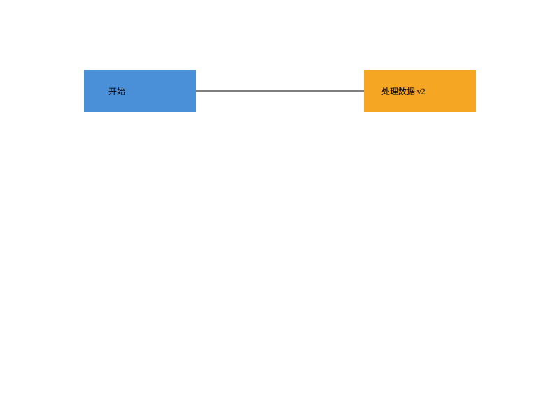

# SVG 命令行编辑器

Lab1 Phase 1，TypeScript 面向对象实现，支持六种图形、嵌套分组、SVG 读写及撤销/重做。

**完整作业文档：[doc/README.md](doc/README.md)**，包括架构方案、PlantUML 图、过程记录、一致性自查、质量保证与实现边界。

```powershell
npm.cmd ci --cache .npm-cache
npm.cmd run cli
```

需要 Node.js 22 或更新版本。Linux/macOS 使用 `npm` 代替 `npm.cmd`。

```powershell
npm.cmd run check
npm.cmd run demo
```

`check` 执行类型检查、31 项测试和构建；`demo` 回放流程图命令，生成 `examples/flowchart.svg`。



输入 `help` 查看全部语法；用 `npm.cmd run cli -- --script examples/session.commands` 回放典型会话。
