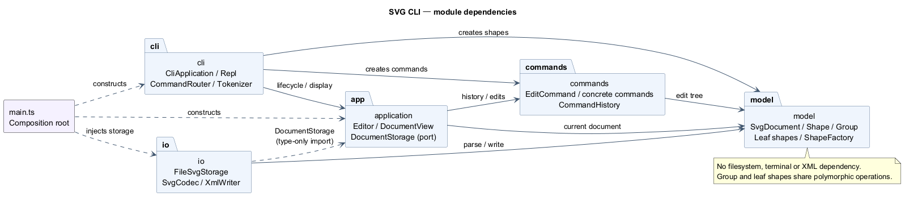

# SVG 命令行编辑器 — Lab1 Phase 1

## 项目信息

- Git 仓库：[bug123654/svg-editor](https://github.com/bug123654/svg-editor)。
- 作业要求：[phase_cli_1.md](../phase_cli_1.md)。
- 本阶段以 TypeScript 面向对象方式实现 CLI，内置 rect、circle、ellipse、line、text、g 六种类型。
- box 和插件加载属于后续阶段；本阶段 create box 明确报未知类型。
- 开发分步提交、分阶段推送；最终验收提交使用 final 标签，过程见仓库 Commits 页面。

## 运行与使用

### 安装、启动和检查

需要 Node.js 22 或更新版本及 npm。实际验证环境为 Windows、Node.js 24.14.1；依赖由 package-lock.json 锁定。

在项目根目录执行。Windows PowerShell 使用 npm.cmd，无需修改执行策略：

```powershell
cd D:\kaifa_lab
npm.cmd ci --cache .npm-cache
npm.cmd run cli
```

Linux/macOS 把 npm.cmd 换成 npm。不需要全局安装；依赖、指定的缓存、构建和临时产物在项目目录内，并由 .gitignore 排除。

```powershell
npm.cmd run check
npm.cmd run demo
npm.cmd run cli -- --script examples/session.commands
```

check 依次进行类型检查、31 项测试和构建。npm.cmd run build 只构建，随后可用 npm.cmd start 启动编译版本。进入交互环境后提示符为 svg>，输入 help 查看全部语法，按 Ctrl+C 或结束输入退出。

--script 直接按 UTF-8 读命令文件，避免终端管道损坏中文；命令内路径相对于启动时工作目录。单条命令错误会打印 error: 并继续后续行；启动参数或脚本读取错误以状态码 1 退出。

### 最小例子与回放产物

```text
init 800 600
create g node
create rect background 120 100 160 60 #4a90d9 in node
create text label 155 135 "开始" in node
move node 0 100
undo
save examples/my-diagram.svg
```

保存的 SVG 可直接在浏览器打开。

| 示例 | 来源和用途 |
|---|---|
| [session.commands](../examples/session.commands) | 第 6 节会话，保存 demo.svg 后读入外部文件 |
| [flowchart.commands](../examples/flowchart.commands) | 第 6.1 节版本 A，嵌套组、中文和整体移动 |
| [other.svg](../examples/other.svg) | 原文外部文件，缺 id 的矩形补为 rect1 |
| [demo.svg](../examples/demo.svg) | 典型会话保存结果，5 个元素 |
| [flowchart.svg](../examples/flowchart.svg) | 流程图保存结果，8 个元素，不计 SVG 根 |

回放有意包含作业指定的错误：保存后撤销被禁止，典型会话还包含一次非法分组。这些输出不是回放失败。实际输出见 [典型会话记录](session-output.txt) 和 [流程图会话记录](flowchart-output.txt)。


### 命令速查

| 类别 | 语法 |
|---|---|
| 文档 | `init [w] [h]`、`read <file.svg>`、`save [file.svg]`、`canvas [w h]` |
| 创建 | `create <type> <id> [params...] [in <containerId>]` |
| 编辑 | `delete <id>`、`move <id> <dx> <dy>`、`scale <id> <factor>`、`set <id> <attr> <value>` |
| 层级 | `group <newGid> <id1> <id2>...`、`ungroup <gid>`、`addto <gid> <id>` |
| 顺序 | `front <id>`、`back <id>` |
| 查看 | `tree [id]`、`show <id>`、`help` |
| 历史 | `undo`、`redo` |

```text
create rect    <id> <x> <y> <w> <h> [fill]
create circle  <id> <cx> <cy> <r> [fill]
create ellipse <id> <cx> <cy> <rx> <ry> [fill]
create line    <id> <x1> <y1> <x2> <y2> [stroke]
create text    <id> <x> <y> "content"
create g       <id>
```

所有类型支持尾部 in 子句。id 必填、全局唯一且区分大小写。以 # 开头的整行是注释，颜色中的 # 不受影响。双引号支持空格与空文本，内部用 \" 和 \\ 表示引号与反斜杠。

set 白名单为 fill、stroke、stroke-width、本类型几何属性，以及文字的 text。矩形属性名是 width、height，不是参数简写 w、h。宽、高、半径、线宽允许零而不允许负数；缩放倍数及画布尺寸须为有限正数。

坐标原点左上，x 向右、y 向下。缩放同时影响位置与尺寸，例如 (10,20,100,50) 乘 2 后为 (20,40,200,100)；按几何属性规则不缩放字体或线宽。容器递归操作子孙。

init 默认 800×600，只给宽则高默认 600。canvas 无参数查看，修改须给宽高。save 首次需路径，之后复用最近一次成功读取或保存的路径。

## 架构方案

### 模块划分

```text
src/
├── model/          文档和图形模型、工厂、结构写出端口
├── commands/       编辑命令和历史
├── application/    会话协调、显示、存储端口
├── io/             SVG 编解码、XML 写出、文件适配器
├── cli/            分词、路由、REPL、脚本输入适配器
└── main.ts         依赖组装
tests/              自动化测试与架构检查
examples/           命令和真实 SVG
doc/                作业文档、图、会话输出
```

| 模块 | 对象与职责 |
|---|---|
| model | Shape 封装几何、样式、父关系；叶子类实现移动与复制；Group 管理子节点并递归行为；SvgDocument 管理画布、查找、唯一性、快照；ShapeFactory 构造六种类型 |
| commands | 命令类保存参数并实现操作；EditCommand 统一事务与快照；CommandHistory 管理撤销栈、重做栈和 IO 屏障 |
| application | Editor 持有当前文档和路径并协调编辑与存储；DocumentView 输出带几何属性的树和明细；DocumentStorage 定义异步存储接口 |
| io | SvgCodec 解析并用统一工厂构造模型；XmlWriter 转义 XML；FileSvgStorage 读写文件，以临时文件再重命名保存 |
| cli | Tokenizer 保留引号信息；CommandRouter 校验并构造命令；Repl 顺序执行；CliApplication 选择交互或 UTF-8 回放 |
| main.ts | 构造对象、注入存储，不承载图形编辑算法 |

PlantUML 包/组件图如下，箭头从使用方指向依赖方。提供 [源文件](architecture.puml) 和可放大的 [SVG](architecture.svg)。



### 设计模式与代码落地

**Command。** CreateCommand、MoveCommand、ScaleCommand、SetCommand、DeleteCommand、GroupCommand、UngroupCommand、AddToCommand、OrderCommand 继承 EditCommand。命令保存目标和参数，通过 apply() 操作文档；路由器不直接修改坐标或子节点列表。

execute() 在文档副本上执行，全部成功后才保存前后快照并发布。失败则丢弃副本，当前文档和历史不变；历史管理器只在成功后入栈。一次 group g a b c 是一个撤销单元，恢复全部成员原父级和顺序；删除容器也恢复子孙。重做恢复执行后的快照，不依赖浮点逆运算或重新解析参数。

**Composite。** Rectangle、Circle、Ellipse、Line、TextShape、Group 都继承 Shape。移动和缩放只调用多态方法，容器递归执行。公共属性由基类校验，文本由 TextShape 覆盖处理。容器样式遵循 SVG 继承，删除针对树节点，不按叶子名字分支。

**Memento 思路。** clone()/restore() 创建独立快照，几何和样式 Map、文本、子节点、父关系不共享可变引用。N 个图形的快照复制或恢复各为 O(N)，所以每次编辑至少有 O(N) 的快照成本；命令本身另有查找及校验开销，跨层分组的成员比较和祖先检查可能更高。H 步历史占用 O(HN)。教学规模优先保证恢复正确，暂不实现增量补丁和历史淘汰。

**工厂与端口。** ShapeFactory 是 CLI 创建和 SVG 导入共用的类型名构造入口。DocumentStorage 隔离磁盘，测试可换内存存储。ShapeWriter 让模型统一写结构，不依赖 XML 库或文件系统。

### 依赖方向规则

| 使用方 | 允许依赖 | 原因 |
|---|---|---|
| model | 本模块 | 领域行为不依赖终端、命令、XML、磁盘 |
| commands | 本模块、model | 只编辑，不处理文件和显示 |
| application | 本模块、commands、model | 协调会话，依赖自己定义的存储接口 |
| io | 本模块、model；仅类型导入 application/DocumentStorage | 具体适配器实现应用层端口 |
| cli | 本模块、application、commands、model | 转换输入，构造图形和命令 |
| main.ts | 以上模块 | 组装具体依赖 |

SVG 磁盘 IO 在 FileSvgStorage；终端和脚本读取是 CLI 输入适配职责。模型、命令、应用层不导入 Node.js IO 或 XML 库。

初稿简写的 io→model 不完整：最终补充 IO 对存储端口的 import type 依赖，并列出 CLI 构造命令和图形的依赖。应用层未反向导入 FileSvgStorage。这些规则由 tests/architecture.test.ts 通过 TypeScript AST 检查。

按名字分派只保留两处，并标为后续待重构点：

1. CommandRouter 的命令名→处理器映射，将来可改命令注册接口。
2. ShapeFactory 的类型名→构造器映射，将来可改 ShapeProvider 注册与参数 schema；当前参数和帮助语法由同一工厂处理。

移动、缩放、复制、写出不使用散落的 switch(tag)；解析器的容器/文字能力判断不另建类型名构造表。

### 变化点假设

| 未来变化 | 留下的边界或不提前实现的理由 |
|---|---|
| 新图形及 box | 统一 Shape 和子树模型，工厂为集中替换点；不宣称完成了零修改插件机制 |
| 新命令、GUI/agent | Command 和 Editor 独立于 REPL，脚本与交互共用路由，可复用应用层 |
| 存储位置或格式 | DocumentStorage 替换文件适配器，ShapeWriter 隔离写出 |
| 更多 SVG 标准 | SvgCodec 集中限制边界，避免 CSS/复杂路径混入当前模型 |
| 大文档或长历史 | 当前线性查找、全量快照足够示例；增长后再加索引、增量历史、容量限制 |
| 预览方式 | 输出标准 SVG 交给浏览器；本阶段不开发 GUI 或内置渲染器 |

## 行为细节与范围

### 层级、顺序与历史

- in 指定创建时父级；group 新建组收编已有元素；addto 把已有元素追加至已有组末尾。
- 分组成员按原文档深度优先顺序。同父时占首个所选元素位置；跨父时置于最近公共父容器，在第一条所选分支位置插入。这是对原文未明确新组父级的确定性补充。
- 容器及子孙不能同时分组；容器不能经 addto 进入自身或后代。
- 解组后子节点替换原组位置；按作业规则，根级容器禁止解组。
- SVG 后面的元素绘制在上层，所以 front 置同级列表末尾，back 置开头。
- tree/show/help/无参数 canvas 不入历史；新编辑成功清空 redo。
- init/read/save/画布修改成功后清空旧历史并建 IO 屏障，直到下一次成功编辑解禁；失败操作不改变历史。

### SVG 读写边界

支持六种元素、嵌套组、几何和公共样式。省略 fill/stroke 时保持省略，使用 SVG 默认渲染；缺失的基础几何属性采用零值。读取先预留全部显式 id，再给缺 id 元素按标签名+序号分配，跳过冲突并在成功后警告。重复 id 或解析错误使整次读取失败，原文档不变。

保存转义文字和属性中的特殊字符；同目录临时文件写完再重命名，避免写入失败留下半份 SVG，并清理本次临时文件。

本实现支持基础 SVG 子集，不宣称覆盖全部标准：

- 支持 SVG 命名空间或无命名空间的基础文件；根 width/height 为数值或 px；viewBox 若存在须为 0 0 width height。
- 明确拒绝 transform、CSS style、path、use、defs、嵌套 tspan，不静默丢失。原文介绍了变换背景；本程序通过递归修改几何坐标移动与缩放，保存不产生 transform。
- 导入保留 font-size、font-family、font-weight、text-anchor、dominant-baseline、opacity、fill-opacity、stroke-opacity、data-kind；它们不加入 CLI set 白名单。
- data-kind="box" 只按普通 g 读回并保留标记，不恢复插件行为，不实现 label 便利属性。
- DOCTYPE 与自定义实体声明不在读写范围。

## 过程记录

本项目由用户与 Codex 协作完成。用户提出命令约束，并控制开发暂停和继续；代码生成、编译定位和自动化检查主要由 Codex 执行。下面按实际讨论和工具结果记录。

### 迭代概览

| 阶段 | 发现或讨论 | 处理与验证 |
|---|---|---|
| 初始化 | 仅有需求，PowerShell 拒绝 npm.ps1 | 使用 npm.cmd，依赖和缓存放项目，不改系统执行策略 |
| 架构先行 | 组合语义和复杂撤销，反向移动不能覆盖删除/分组 | 先写方案；模型封装行为，快照恢复父级、顺序及数值，记录性能取舍 |
| 安装纠正 | 并发安装同一目录导致文件缺失 | 后续顺序安装并锁依赖，不把失败当作验证成功 |
| 进度备份 | 用户暂停后提供 GitHub 地址 | 保留历史，以 WIP 备份未验收代码，绑定并推送，不提前打 final |
| 2026-10-27 类型修复 | XML 库 localName 可空，初稿未通过类型检查 | tagName 回退，26 项测试及构建通过；单独推送 51cca37 |
| 2026-10-27 会话验收 | 基础测试不足以覆盖完整会话，管道可能损坏中文 | 加 UTF-8 脚本、两份需求会话、子进程和架构测试；31 项通过，推送 78156e1 |
| 2026-10-28 帮助 | 泛化 create 提示未列类型参数 | 同一工厂生成六种语法并验证，31 项通过；单独提交 2b7c0d9 |
| 文档收尾 | 初稿未完整说明 CLI 依赖和存储接口类型依赖 | 按实际导入修订，补 PlantUML 图、运行方式、边界、验收和自查，独立提交文档 |

GitHub 连接重置时使用仅对命令生效的 HTTP/1.1 重试，未改全局 Git 配置。源代码、示例、缓存、预览和临时工具均限定在项目内，未改桌面问题记录文件；项目中不保存密码或令牌。

### 关键讨论与迭代案例

#### 1. 撤销设计：从单个移动例子扩展到完整的树结构恢复

**讨论的问题。** 早期讲解以移动前后的位置解释撤销，但这不足以说明删除、分组、跨容器移动和显示顺序的恢复。比如删除一个组后，撤销不仅要找回图形，还要恢复全部子孙、原父级和同级顺序；一次分组也必须整体撤销。

**设计与确认。** 采用 Command 封装一次编辑，并在文档副本上完成操作，成功后才发布；命令保存操作前后的独立快照。测试不只检查“撤销成功”的提示，还比较操作前后的序列化内容及父子关系，覆盖删除子树、跨父级分组、解组和 front/back。

**验证结果与取舍。** `editor.test.ts` 还测试了容器内某个子节点在缩放时数值溢出的情况：即使副本中的前一个子节点已经改变，失败也不能污染当前文档。快照方案通过这些检查，但增加了复制和历史存储成本，相关代价在架构方案中明确记录。这是设计讨论后验证的风险，不表示曾在用户文档中发生过数据丢失。

#### 2. AI 生成代码的类型错误：不能只凭变量名猜测原因

**发现的问题。** 最初生成的 SVG 读取代码直接把 XML 元素的 `localName` 用作类型名。运行 TypeScript 检查后出现 `string | null` 不能作为 `string` 参数的错误，说明代码虽然看起来合理，却未满足实际依赖库的类型约束。

**确认过程。** 第一轮调整先处理了 id 的空值，但再次检查仍有错误。随后查看具体报错行与 XML 库的声明，确认真正影响类型名映射的是 `Element.localName` 可空，而不是只需要调整 id。

**修正方法。** 为类型名添加回退：

```typescript
const type = element.localName ?? element.tagName;
```

保留读取失败不替换原文档的处理。修正后运行 `npm.cmd run check`，当时的 26 项测试、类型检查与构建全部通过，并以 `51cca37` 独立提交。

**得到的认识。** AI 的代码和第一次修正都需要检查。类型错误应结合报错位置、依赖库声明和重新运行结果判断，不能仅凭直觉修改一个相似变量就认为问题解决。

#### 3. 验证范围的补充：基础测试通过不等于覆盖作业完整会话

**发现的问题。** 26 项基础测试通过后，仍需证明原文第 6 节及第 6.1 节版本 A 能连续运行，特别是异步读写、中文、分组错误及保存后的撤销屏障。Windows 的终端管道编码也会影响中文脚本回放的可复现性。

**确认与处理。** 将原文会话整理成 `examples/session.commands` 和 `examples/flowchart.commands`，增加按 UTF-8 直接读取文件的 `--script` 入口，并复用同一个路由器和编辑器。新增完整会话、真实 CLI 子进程、中文文件往返以及架构测试，检查保存后的坐标、文本、归属和元素数量。

**验证结果。** 检查数增加到 31 项并全部通过；真实运行两份脚本后保留了输出与 SVG。会话中的非法分组和保存后撤销错误，按需求作为预期结果核对，不把出现 `error:` 简单等同于测试失败。该阶段以 `78156e1` 单独提交推送。

**得到的认识。** 验证依据需要对应需求，而不只是累计测试数量；关键流程应检查真实状态和产物，尤其要区分“按要求拒绝非法操作”和程序缺陷。

#### 4. 帮助信息的修正：功能可调用还需要参数说明可用

**发现的问题。** 最初 help 对创建命令只列出泛化的 `create ... [params...]`，用户仍无法据此知道矩形、直线和文字各自需要哪些参数。这不够贴合“显示全部命令与语法”的要求。

**处理方法。** 在 `ShapeFactory.syntax()` 中，根据现有构造入口及图形属性生成六种类型的完整语法，再由 help 展示，避免另设一份类型名分发表。补充矩形、直线和文字语法的断言。

**验证结果。** 2026-10-28 再次运行全部检查，31 项测试、类型检查和构建通过，以 `2b7c0d9` 独立提交。

**得到的认识。** 需求验收不仅检查命令能否执行，也要检查用户是否能从帮助中获得足够信息；相同的类型知识应尽量由同一入口维护。

#### 5. 架构文档的修订：以实际依赖核对方案

**发现的问题。** 架构初稿用 `io → model` 概括 IO 依赖，但实际 `FileSvgStorage` 还以 `import type` 引用了应用层的 `DocumentStorage`；CLI 为构造图形和命令，也直接使用了 model 与 commands。若文档只保留简化箭头，就与代码不完全一致。

**确认与修正。** 对照各模块的实际 import，确认存储接口由应用层定义、具体 IO 实现该接口，应用层没有反向导入磁盘实现。最终依赖表和 PlantUML 图补全这些方向，并明确 IO 到应用层只能是该存储端口的类型依赖。

**验证结果。** `architecture.test.ts` 使用 TypeScript AST 检查全部生产文件的导入方向，对这个类型依赖设定专门约束，同时检查一类一文件及类名与文件名一致。检查通过后，在一致性自查中如实说明初稿修订。

**得到的认识。** 架构图和规则需要随实现复核；发现差异时应说明其设计理由，并用检查固定边界，而不是只把文档写成理想结构。

## 一致性自查

### 模块划分

实际保持五个模块和 main.ts。新增 CliApplication 在 cli 中，无新增架构层；tests/examples/doc 不被生产代码反向依赖。生产类一类一文件，文件名等于类名；接口 ShapeWriter、DocumentStorage 各自成文件；main 只组装依赖。

几何、样式、历史、子节点使用私有字段，读取返回副本或只读视图。行为在模型方法中，不用公共数据袋加自由函数替代对象设计。

### 依赖方向

架构检查覆盖全部生产文件，当前没有未记录的模块方向例外。抽样如下：

| 位置 | 实际依赖与结论 |
|---|---|
| MoveCommand | 依赖文档与基类，通过多态移动，不按类型名分支 |
| Editor | 模型、历史、存储接口，不导入磁盘实现 |
| FileSvgStorage | 模型、编解码、存储端口类型，具体 IO 隔离 |
| Shape.writeTo | 仅依赖模型中的 ShapeWriter，不导入 XML 库 |
| CommandRouter | 构造图形及命令，与最终依赖表一致 |

两处名称映射和全量快照的扩展性代价仍在，已列为待重构点，不将阶段实现描述为成熟插件架构。

## 质量保证手段

### 自动检查

2026-10-28 实际执行 npm.cmd run check：类型检查通过、31 项测试全部通过、构建成功。测试核对几何、父关系、顺序、文本、历史和保存内容，不只匹配成功提示。

另在项目 .tmp 下创建不带原 node_modules 的干净副本，按 package-lock.json 执行 npm ci，再运行全部检查；依赖安装、31 项测试及构建均通过，确认结果不依赖原工作目录中的依赖残留。

| 测试文件 | 覆盖 |
|---|---|
| editor.test.ts | 六种类型、全部编辑、白名单、历史分支、IO 屏障、失败原子性、溢出、引号与参数 |
| svg.test.ts | 外部文件、id 预留、中文转义、样式/插件标记、非法导入、往返稳定 |
| files.test.ts | 真实保存、覆盖、读回、默认路径、失败历史和临时文件清理 |
| cli.test.ts | 子进程、stdin、异步顺序、UTF-8 脚本、中文文件往返、启动错误 |
| acceptance.test.ts | 第 6 节、第 6.1 节版本 A，核对预期错误与保存状态 |
| architecture.test.ts | 依赖、一类一文件、类名匹配、内层无外部 IO |

文件测试只在项目 .tmp 创建临时目录，清理前核对绝对路径位于预定目录内。

### 产物验收与限制

两份脚本实际运行并保留输出，核对元素计数、坐标、中文与读回结果。整体移动后撤销可恢复，文字修改可保存并读回。两份 SVG 另行渲染检查节点、连线和中文；架构图由附带的 PlantUML 源生成。

验证覆盖本阶段六种类型与命令，不代表覆盖完整 SVG 标准、GUI、插件或大型文档性能；实现边界已列明。

### 最终提交

验收后独立提交文档并推送 main，在最终提交上创建并推送 final，再比较本地与远程提交及标签。
